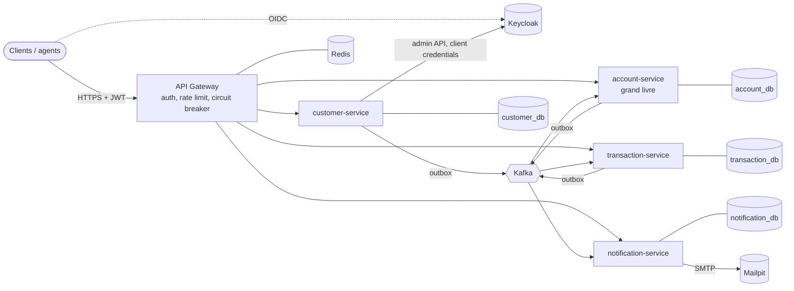

# Atlas Bank

Système bancaire (core banking simplifié) en microservices **Spring Boot 4 / Java 21** : enrôlement
des clients avec contrôle KYC en 4 yeux, comptes et grand livre en partie double, virements,
versements et retraits, notifications multilingues. L'ensemble est conçu comme un système
d'entreprise : sécurité *zero trust*, cohérence des fonds garantie, architecture hexagonale vérifiée
par les tests, configuration externalisée et observabilité de bout en bout.

> Toutes les décisions structurantes sont expliquées dans [`docs/adr/`](docs/adr) et la vue
> d'ensemble dans [`docs/architecture.md`](docs/architecture.md).

---

## Sommaire

1. [Fonctionnalités](#fonctionnalités)
2. [Architecture](#architecture)
3. [Démarrage rapide](#démarrage-rapide)
4. [Utiliser l'API](#utiliser-lapi)
5. [Sécurité](#sécurité)
6. [Cohérence des transactions](#cohérence-des-transactions)
7. [Tests et qualité](#tests-et-qualité)
8. [Configuration](#configuration)
9. [Structure du dépôt](#structure-du-dépôt)
10. [Exploitation](#exploitation)
11. [Limites connues et suite](#limites-connues-et-suite)

---

## Fonctionnalités

| Domaine | Ce qui est couvert |
|---|---|
| **Clients** | Enrôlement par un agent ; validation KYC par un **autre** agent (principe des 4 yeux) ; suspension, réactivation, clôture ; mise à jour des coordonnées ; historique d'audit complet (qui, quoi, quand) ; création automatique du compte de connexion Keycloak à l'activation, désactivation à la suspension |
| **Comptes** | Comptes courant et épargne, IBAN générés (format marocain, clé ISO 13616) ; catalogue produits par type **et** devise (découvert, plafond journalier) ; gel / dégel / clôture ; relevé paginé ; gel automatique des comptes d'un client suspendu, levé à sa réactivation |
| **Opérations** | Virement (client ou agent), versement et retrait espèces (agent uniquement) ; en-tête `Idempotency-Key` obligatoire ; plafond par opération ; plafond journalier de débit par compte ; suivi d'état `PENDING → COMPLETED / REJECTED` avec motif |
| **Notifications** | E-mails transactionnels en **français, anglais, arabe** selon la langue du client ; montants formatés selon la langue ; numéros de compte masqués ; consultation paginée |

## Architecture



| Service | Rôle | Données possédées |
|---|---|---|
| `api-gateway` | Point d'entrée unique : validation JWT, limitation de débit (Redis), disjoncteurs, en-têtes de sécurité, console OpenAPI agrégée | — |
| `customer-service` | Clients, cycle de vie KYC, provisionnement des comptes de connexion | Clients (CIN chiffré), audit |
| `account-service` | Comptes et **grand livre** : seul endroit où l'argent bouge | Comptes, écritures, reçus d'imputation, projection des titulaires |
| `transaction-service` | Réception et suivi des ordres de paiement, idempotence HTTP | Ordres de paiement |
| `notification-service` | Notifications déclenchées par les événements | Destinataires (projection), notifications |

Modules partagés (`platform/`) : `atlas-commons` (noyau sans framework : `Money`, erreurs métier,
`Requester`), `atlas-event-contracts` (contrats d'événements versionnés), `atlas-spring-boot-starter`
(sécurité, erreurs RFC 9457, audit JPA, Kafka, OpenAPI, configuration partagée),
`atlas-test-support` (règles ArchUnit, Testcontainers, jetons de test).

**Stack** : Java 21, Spring Boot 4.0.8, Spring Cloud 2025.1.3 (Gateway), Spring Modulith 2.0 (outbox),
Hibernate 7.2 + Envers, PostgreSQL 18, Kafka 4.3 (KRaft), Keycloak 26.8, Redis 8, Flyway, MapStruct,
iban4j, libphonenumber, Testcontainers 2, ArchUnit.

## Démarrage rapide

### Prérequis

- JDK 21 (Maven est fourni par le wrapper `./mvnw`)
- Docker avec au moins **4 Go de RAM** alloués et **6 Go d'espace disque libre** (images et données)

### Lancer la pile complète

```bash
cp .env.example .env              # puis remplacez chaque valeur (secrets locaux, jamais versionnés)
./mvnw -DskipTests package         # construit les 5 jars (mvnw.cmd sous Windows)
docker compose up -d --build      # infrastructure + services (~2 min au premier démarrage)
docker compose ps                 # tous les services doivent être "healthy"
```

Puis jouez le scénario complet de démonstration (enrôlement → virement → notifications) :

```powershell
./scripts/smoke-test.ps1
```

| URL | Usage |
|---|---|
| http://localhost:8080/swagger-ui.html | Console API (connexion OAuth2 PKCE via Keycloak) |
| http://localhost:8180 | Keycloak (console d'administration : `admin` / `KEYCLOAK_ADMIN_PASSWORD`) |
| http://localhost:8025 | Mailpit : boîte de réception des e-mails envoyés |

Comptes de démonstration (environnement local uniquement, mots de passe dans `.env`) :

| Identifiant | Rôle |
|---|---|
| `admin.atlas` | `ADMIN` (hérite de `EMPLOYEE`) |
| `agent.amina`, `agent.youssef` | `EMPLOYEE` — deux agents pour illustrer le contrôle en 4 yeux |

Les comptes **clients** ne sont jamais créés à la main : ils sont provisionnés par
customer-service quand un dossier est validé, et le client reçoit un e-mail pour choisir son mot de
passe.

Observabilité optionnelle (traces distribuées et métriques dans Grafana, http://localhost:3000) :

```bash
docker compose -f compose.yaml -f deploy/compose.observability.yaml up -d
```

## Utiliser l'API

Toutes les routes passent par la gateway (`http://localhost:8080`) et exigent un jeton d'accès.

```bash
# Jeton d'un agent (client "atlas-dev-cli", réservé aux environnements locaux)
TOKEN=$(curl -s -d grant_type=password -d client_id=atlas-dev-cli \
  -d username=agent.amina -d password="$ATLAS_DEMO_EMPLOYEE_PASSWORD" \
  http://localhost:8180/realms/atlas-bank/protocol/openid-connect/token | jq -r .access_token)

# Enrôler un client
curl -s -X POST http://localhost:8080/api/v1/customers -H "Authorization: Bearer $TOKEN" \
  -H 'Content-Type: application/json' -d '{
    "firstName": "Salma", "lastName": "Benali", "email": "salma@example.ma",
    "phoneNumber": "0612345678", "dateOfBirth": "1992-04-18", "nationalId": "BK123456",
    "address": {"line": "12 avenue Mohammed V", "city": "Rabat", "postalCode": "10000", "country": "MA"}}'

# Ordonner un virement (202 Accepted + Location vers l'ordre à suivre)
curl -s -X POST http://localhost:8080/api/v1/transactions/transfers -H "Authorization: Bearer $TOKEN" \
  -H "Idempotency-Key: $(uuidgen)" -H 'Content-Type: application/json' -d '{
    "sourceAccountNumber": "MA..", "targetAccountNumber": "MA..", "amount": 250.00, "currency": "MAD"}'
```

| Ressource | Endpoints principaux | Rôles |
|---|---|---|
| Clients | `POST /api/v1/customers`, `GET /api/v1/customers?query=&status=`, `GET /me`, `GET /{id}`, `PUT /{id}/contact`, `POST /{id}/verification`, `/suspension`, `/reinstatement`, `/closure`, `GET /{id}/history` | agents ; le client ne voit que lui-même ; clôture et audit : `ADMIN` |
| Comptes | `POST /api/v1/accounts`, `GET /api/v1/accounts?customerId=&status=&type=`, `GET /{id}`, `GET /{id}/entries?from=&to=`, `POST /{id}/freeze`, `/unfreeze`, `/closure` | client (ses comptes) ou agent |
| Opérations | `POST /api/v1/transactions/transfers`, `/deposits`, `/withdrawals`, `GET /api/v1/transactions?status=&kind=&accountNumber=&from=&to=`, `GET /{id}` | virement : client ou agent ; espèces : agent |
| Notifications | `GET /api/v1/notifications` | client (les siennes) ou agent |

Conventions communes :

- **Pagination** sur toutes les listes : `?page=0&size=20&sort=champ,desc`. La taille est plafonnée
  à 100 par la configuration ; les réponses ont la forme stable `{content: [...], page: {size, number, totalElements, totalPages}}`.
- **Erreurs** au format [RFC 9457](https://www.rfc-editor.org/rfc/rfc9457) (`application/problem+json`)
  avec un `code` métier stable, un `traceId` pour le support et, pour la validation, la liste des champs en erreur :

```json
{
  "type": "urn:atlasbank:problem:insufficient-funds",
  "title": "Unprocessable Content",
  "status": 422,
  "detail": "Insufficient funds on account MA64...",
  "instance": "/api/v1/...",
  "code": "INSUFFICIENT_FUNDS",
  "traceId": "4bf92f3577b34da6a3ce929d0e0e4736",
  "timestamp": "2026-10-12T09:41:12.381Z"
}
```

- **Opérations asynchrones** : un ordre de paiement répond `202 Accepted` avec un en-tête `Location`
  relatif ; un client qui renvoie la même requête avec la même `Idempotency-Key` reçoit l'ordre
  d'origine (`Idempotent-Replayed: true`) au lieu d'un second débit.

## Sécurité

| Menace | Mesure |
|---|---|
| Accès non authentifié | OAuth2 / OpenID Connect (Keycloak) ; chaque service **revalide** le JWT (signature, émetteur, audience `atlas-api`, expiration) même derrière la gateway (*zero trust*) |
| Élévation de privilèges | Rôles `CUSTOMER` / `EMPLOYEE` / `ADMIN` avec hiérarchie déclarée une seule fois ; annotations `@StaffOnly`, `@AdminOnly`, `@CustomerOrStaff` sur chaque endpoint |
| Accès aux données d'autrui (IDOR) | Contrôle de propriété dans la couche application via le claim `customer_id` ; une ressource d'autrui répond **404** (indiscernable d'une ressource inexistante) |
| Fraude interne | Validation KYC en 4 yeux (le validateur doit différer du créateur, imposé par le domaine **et** par une contrainte SQL) ; audit Envers de chaque modification avec son auteur |
| Débit d'un compte d'autrui | Le grand livre revérifie la propriété du compte débité, sans faire confiance au service amont ; un IBAN inexistant renvoie le même refus, pour ne pas révéler son existence |
| Fuite de données personnelles | CIN chiffré en AES-256-GCM (Spring Security Crypto), doublons détectés par HMAC-SHA256 (*blind index*), CIN toujours masqué dans l'API, IBAN masqués dans les e-mails, coordonnées non publiées sur Kafka au-delà du nécessaire |
| Rejeu, double paiement | `Idempotency-Key` obligatoire, empreinte SHA-256 de la requête pour détecter la réutilisation d'une clé avec un contenu différent |
| Force brute, abus | Détection de force brute Keycloak, politique de mot de passe forte, rate limiting par utilisateur ou IP à la gateway, taille des requêtes limitée |
| Attaques navigateur | En-têtes de sécurité (CSP `default-src 'none'`, `X-Frame-Options`, `nosniff`, `Referrer-Policy`), CORS restreint et configurable, aucun cookie transmis aux services |
| Désérialisation hostile | Aucun nom de classe ne circule sur Kafka : les payloads JSON sont liés au type attendu par le consommateur |
| Secrets | Aucun secret dans le code ni dans la configuration versionnée ; le démarrage échoue si une clé manque ; `.env` ignoré par Git |
| Fuite d'informations techniques | Ni stack trace, ni message interne, ni SQL dans les réponses d'erreur |
| Exécution des conteneurs | Images minimales, utilisateur non-root, services non exposés hors de la gateway |
| Dépendances vulnérables | Profil Maven `security-scan` (OWASP dependency-check, échec si CVSS ≥ 7), exécuté chaque semaine en CI |

## Cohérence des transactions

L'argent ne bouge qu'à un seul endroit : le **grand livre** d'account-service. Le flux d'un virement :

1. transaction-service valide la requête, enregistre l'ordre `PENDING` **et** l'événement
   `TransactionRequested` dans **la même transaction** locale (*transactional outbox*, Spring Modulith).
   Il ne peut donc ni perdre l'ordre, ni le publier sans l'avoir enregistré.
2. account-service consomme l'ordre et, dans une transaction ACID locale :
   - verrouille les comptes concernés (`SELECT … FOR UPDATE`) **dans l'ordre croissant des numéros**,
     ce qui rend tout interblocage impossible entre deux virements croisés ;
   - vérifie le reçu d'imputation **sous verrou** : un ordre redélivré n'a aucun effet (consommateur idempotent) ;
   - revérifie statut, devise, propriété, provision (découvert compris) et plafond journalier ;
   - écrit le débit, le crédit, le reçu et l'événement `TransactionOutcome` (outbox).
3. Un rejet métier annule toute la tentative et est enregistré dans une **transaction séparée** :
   aucun débit partiel ne peut subsister.
4. transaction-service et notification-service consomment le résultat.

Garde-fous en base : solde jamais sous le découvert autorisé (contrainte `CHECK`), écritures du grand
livre **immuables** (trigger PostgreSQL), unicité d'une écriture par ordre et par compte.

## Tests et qualité

```bash
./mvnw test      # tests unitaires, slices web sécurisées, règles d'architecture (sans Docker)
./mvnw verify    # + tests d'intégration sur PostgreSQL, Kafka et Redis réels (Testcontainers, Docker requis)
```

| Niveau | Exemples |
|---|---|
| Domaine | machine à états client, règle des 4 yeux, débit, crédit, découvert, plafond journalier, gel, clôture, `Money` |
| Architecture | ArchUnit : sens des dépendances entre couches, domaine sans framework, couche application indépendante du web et de Kafka |
| Web + sécurité | 401 / 403 par rôle, format RFC 9457, validation, hiérarchie de rôles |
| Intégration | enrôlement complet, chiffrement au repos, audit, **virements concurrents croisés sans interblocage ni perte d'argent**, idempotence, rejet sans effet de bord, chaîne Kafka complète, rate limiting, disjoncteur |

## Configuration

Toute valeur dépendant de l'environnement est une variable d'environnement. Les conventions
communes (Kafka, JPA, sécurité, actuator…) sont fournies par le starter de plateforme avec la priorité la
plus faible : chaque service, puis chaque déploiement, peut les surcharger.

| Variable | Usage |
|---|---|
| `ATLAS_DB_HOST`, `ATLAS_DB_USERNAME`, `ATLAS_DB_PASSWORD` | Base du service |
| `ATLAS_KAFKA_BOOTSTRAP_SERVERS` | Brokers Kafka |
| `ATLAS_OIDC_ISSUER_URI`, `ATLAS_OIDC_JWK_SET_URI` | Émetteur public des jetons, clés de signature (URL interne) |
| `ATLAS_KEYCLOAK_URL`, `ATLAS_CUSTOMER_SERVICE_CLIENT_SECRET` | Provisionnement des comptes de connexion |
| `ATLAS_PII_ENCRYPTION_PASSWORD`, `ATLAS_PII_ENCRYPTION_SALT`, `ATLAS_PII_FINGERPRINT_KEY` | Protection des données personnelles |
| `ATLAS_REDIS_*`, `ATLAS_RATE_LIMIT_PER_SECOND`, `ATLAS_RATE_LIMIT_BURST`, `ATLAS_CORS_ALLOWED_ORIGINS` | Gateway |
| `ATLAS_SMTP_*`, `ATLAS_MAIL_FROM` | Envoi des e-mails |

Règles métier configurables (sans recompilation) : âge minimum et langues
(`atlas.customers.*`), catalogue produits et limites (`atlas.accounts.products`), plafonds par ordre
(`atlas.transactions.max-amount-per-order`), code banque et agence des IBAN
(`atlas.accounts.numbering`), fuseau horaire bancaire (`atlas.platform.zone-id`).

## Structure du dépôt

```
atlas-bank/
├── platform/
│   ├── atlas-commons/              noyau partagé sans framework
│   ├── atlas-event-contracts/      événements Kafka versionnés (langage publié)
│   ├── atlas-spring-boot-starter/  conventions transverses (auto-configurations)
│   └── atlas-test-support/         ArchUnit, Testcontainers, jetons de test
├── services/
│   ├── customer-service/
│   ├── account-service/
│   ├── transaction-service/
│   └── notification-service/
├── edge/api-gateway/
├── deploy/                         realm Keycloak, init PostgreSQL, observabilité
├── scripts/smoke-test.ps1          scénario de bout en bout
├── docs/                           architecture, ADR, plan
├── compose.yaml
└── Dockerfile
```

Chaque service suit la même organisation hexagonale :

```
ma.atlasbank.<service>
├── domain/          agrégats, objets valeur, règles métier, codes d'erreur (aucune dépendance Spring)
├── application/     cas d'usage, ports (interfaces), commandes, vues
├── infrastructure/  adaptateurs : persistance, Kafka, Keycloak, SMTP, crypto
└── web/             contrôleurs REST
```

## Exploitation

| Besoin | Où regarder |
|---|---|
| Santé, sondes Kubernetes | `/actuator/health/liveness`, `/actuator/health/readiness` |
| Métriques | `/actuator/prometheus` (tag `application` sur chaque métrique) |
| Traces | OTLP vers Tempo (surcouche d'observabilité) ; propagées via HTTP **et** Kafka |
| Logs | JSON structurés (ECS) en conteneur, avec `traceId` / `spanId` |
| Messages en échec | Topics `<topic>.dlt` : message d'origine intact et en-têtes de diagnostic, après 5 tentatives avec back-off exponentiel |
| Outbox | Table `event_publication` de chaque service ; les publications non livrées sont resoumises automatiquement |

## Limites connues et suite

Ce dépôt est une base de production réaliste, pas un système homologué. Pour aller plus loin :

- **Déploiement** : manifestes Kubernetes / Helm, Keycloak en mode `start --optimized` avec TLS,
  Kafka en cluster (réplication 3, ACL par service, SASL/mTLS), PostgreSQL managé avec sauvegardes.
- **Sécurité** : MFA obligatoire pour les agents (politique OTP déjà configurée dans le realm),
  stockage des clés dans un coffre (Vault, KMS) avec rotation, terminaison TLS à l'ingress.
- **Fonctionnel** : virements externes (compensation interbancaire), change de devises, intérêts
  d'épargne, frais, relevés PDF, ordres permanents, plafonds par client.
- **Interface** : application web ou mobile cliente (le client OAuth2 `atlas-web` est prêt, en PKCE).
