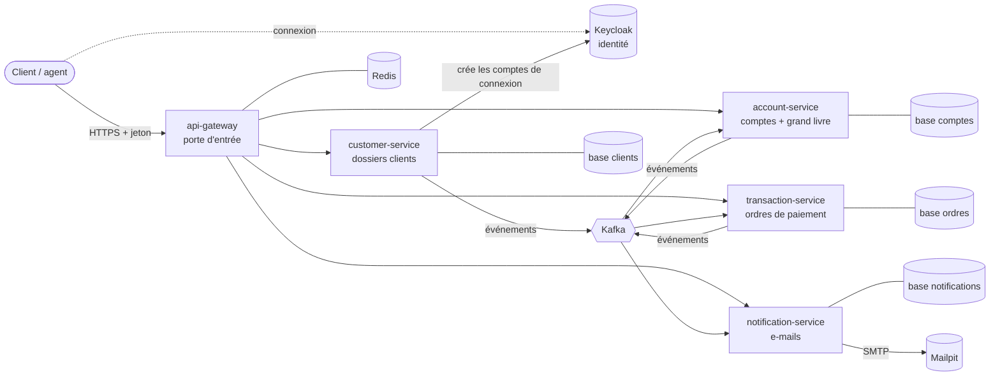
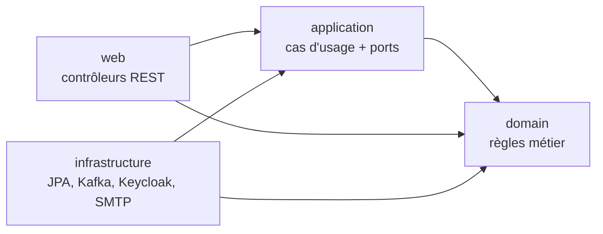
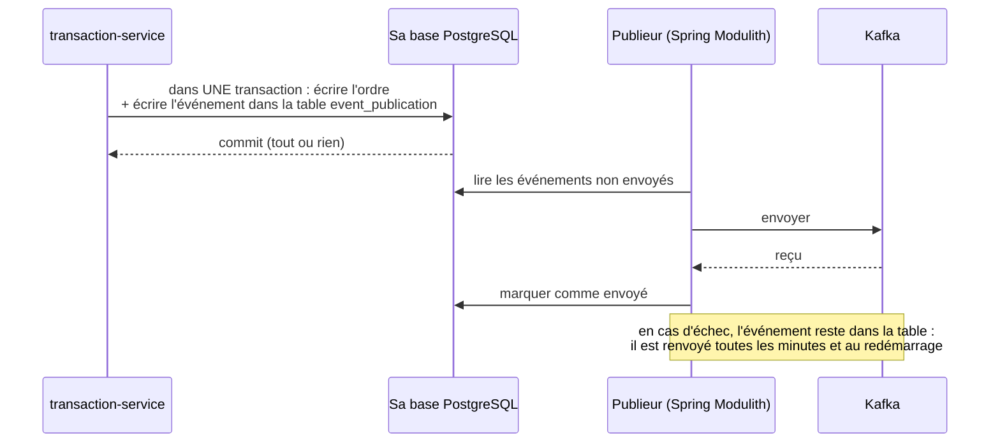
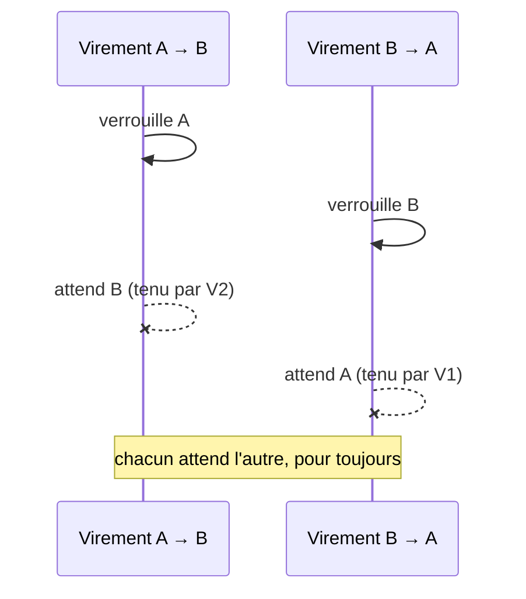

# Guide de compréhension d'Atlas Bank

Ce guide explique **comment fonctionne toute l'application** et **pourquoi elle est construite ainsi**.
Il ne suppose aucune connaissance préalable des patterns utilisés : chaque notion est expliquée à
partir du problème qu'elle résout.

Chaque partie suit la même logique :

- **Le problème** : ce qui irait mal sans la solution ;
- **La solution** : ce que fait l'application ;
- **Pourquoi ce choix** : les alternatives et ce qu'elles coûteraient ;
- **Dans le code** : où le voir.

> Les documents plus courts et plus techniques restent la référence : [`architecture.md`](architecture.md)
> (vue d'ensemble) et [`adr/`](adr) (une décision par fichier). Ce guide les relie et les explique.

---

## Sommaire

1. [Ce que fait l'application](#1-ce-que-fait-lapplication)
2. [Les pièces du puzzle](#2-les-pièces-du-puzzle)
3. [Pourquoi des microservices](#3-pourquoi-des-microservices)
4. [L'intérieur d'un service : l'architecture hexagonale](#4-lintérieur-dun-service--larchitecture-hexagonale)
5. [Le starter de plateforme : écrire les règles communes une seule fois](#5-le-starter-de-plateforme--écrire-les-règles-communes-une-seule-fois)
6. [Comment les services se parlent : les événements](#6-comment-les-services-se-parlent--les-événements)
7. [L'argent : le grand livre](#7-largent--le-grand-livre)
8. [Les ordres de paiement](#8-les-ordres-de-paiement)
9. [Identité, droits et sécurité](#9-identité-droits-et-sécurité)
10. [Les données personnelles](#10-les-données-personnelles)
11. [Concurrence : qui gagne quand deux actions arrivent en même temps ?](#11-concurrence--qui-gagne-quand-deux-actions-arrivent-en-même-temps-)
12. [Les erreurs renvoyées par l'API](#12-les-erreurs-renvoyées-par-lapi)
13. [Configuration et secrets](#13-configuration-et-secrets)
14. [Observabilité : savoir ce qui se passe](#14-observabilité--savoir-ce-qui-se-passe)
15. [Les tests et la CI](#15-les-tests-et-la-ci)
16. [Le déploiement local](#16-le-déploiement-local)
17. [Récapitulatif : un problème, une réponse](#17-récapitulatif--un-problème-une-réponse)
18. [Glossaire](#18-glossaire)
19. [Où trouver quoi dans le code](#19-où-trouver-quoi-dans-le-code)

---

## 1. Ce que fait l'application

Atlas Bank est une **banque simplifiée** (on parle de *core banking*, le cœur du système d'information
d'une banque). Trois types de personnes l'utilisent :

| Acteur | Rôle technique | Ce qu'il peut faire |
|---|---|---|
| **Client** | `CUSTOMER` | Voir son dossier, ses comptes et leurs relevés ; faire des virements depuis ses propres comptes ; modifier son téléphone et son adresse ; lire ses notifications |
| **Agent** (guichetier, back-office) | `EMPLOYEE` | Enrôler un client, valider le dossier d'un client enrôlé par un collègue, ouvrir et geler des comptes, enregistrer des versements et retraits d'espèces, faire des virements pour un client, approuver les opérations d'un collègue |
| **Administrateur** (superviseur) | `ADMIN` | Tout ce que fait un agent, plus : clôturer un client, lever une suspension ou un gel, consulter l'historique d'audit, vérifier l'équilibre des livres |

Le parcours type :

1. Un agent **enrôle** un client (identité, CIN, coordonnées). Le dossier est « en attente de vérification ».
2. Un **autre** agent **valide** le dossier (contrôle KYC, *Know Your Customer*). Le client devient actif.
3. Le système **crée automatiquement** son compte de connexion. Le client reçoit un e-mail pour choisir son mot de passe.
4. Un agent **ouvre** un compte courant et un compte épargne. Chacun reçoit un IBAN marocain.
5. Le client **dépose** de l'argent au guichet (enregistré par l'agent), puis **fait un virement** en ligne.
6. Le client reçoit un **e-mail** à chaque mouvement, dans sa langue (français, anglais ou arabe).

---

## 2. Les pièces du puzzle



Une analogie aide à situer chaque pièce. Imagine une agence bancaire :

| Composant | Dans l'agence, c'est… | Son travail technique |
|---|---|---|
| **api-gateway** | L'accueil, à l'entrée | Seul point d'entrée : vérifie le badge (jeton), filtre les abus (limitation de débit), oriente vers le bon service, renvoie « réessayez plus tard » si un service ne répond pas |
| **Keycloak** | Le service qui délivre les badges | Gère les identités, les mots de passe, le second facteur ; émet des jetons signés |
| **customer-service** | Le service des dossiers clients | Enrôlement, validation KYC, suspension, clôture ; chiffre le numéro de CIN |
| **account-service** | La comptabilité et le coffre | Les comptes et le **grand livre** : le seul endroit où l'argent bouge |
| **transaction-service** | Le guichet des ordres | Reçoit les demandes de virement, de versement et de retrait ; les contrôle ; gère le 4 yeux ; les transmet au grand livre |
| **notification-service** | Le service courrier | Envoie les e-mails |
| **Kafka** | Le courrier interne entre services | Transporte les **événements** (« tel client a été validé », « tel ordre a été exécuté ») |
| **PostgreSQL** | Les armoires de classement | Une base de données par service, que personne d'autre n'ouvre |
| **Redis** | Le compteur de visites de l'accueil | Compte les requêtes de chaque utilisateur pour la limitation de débit |
| **Mailpit** | Une fausse boîte aux lettres | En local, capture les e-mails au lieu de les envoyer (http://localhost:8025) |

---

## 3. Pourquoi des microservices

### Le problème

Dans une application « monolithe » (un seul programme, une seule base), tout est mélangé. Une
modification des notifications peut casser les virements, et toute l'équipe travaille dans le même
code. On ne peut pas non plus faire grandir une seule partie sans l'autre.

### La solution

L'application est découpée en **quatre services métier** (plus la gateway), chacun responsable d'un
domaine. Le découpage suit une règle simple : **une donnée, un propriétaire**.

- customer-service est le seul à connaître les dossiers clients complets ;
- account-service est le seul à connaître les soldes ;
- et ainsi de suite.

Chaque service a **sa propre base de données**, et aucun service ne lit la base d'un autre. Quand un
service a besoin d'une information d'un autre domaine, il la reçoit **par événement** et en garde une
copie locale (voir la [partie 6.5](#65-chacun-garde-sa-copie--event-carried-state-transfer)).

Autre règle forte : **aucun appel synchrone entre services**. account-service ne téléphone jamais à
customer-service pour savoir si un client est actif : il le sait déjà, grâce aux événements reçus.

### Pourquoi ce choix

| Avantage | Explication |
|---|---|
| Indépendance | Une panne de notification-service ne bloque ni les virements ni l'enrôlement |
| Clarté | Chaque service a un rôle précis et un code plus petit |
| Sécurité | Chaque service n'a accès qu'à ses données : une faille dans l'un ne donne pas tout |

Les microservices ont aussi un **coût**, qu'il faut assumer :

- plusieurs bases et plusieurs programmes à faire tourner ;
- les données entre services ne sont pas synchronisées à l'instant : on parle de **cohérence à terme**,
  quelques millisecondes en temps normal ;
- il faut gérer les messages perdus ou en double (voir partie 6).

Le choix « pas d'Eureka, pas de Config Server » (souvent vus dans les tutoriels Spring Cloud) est
expliqué dans l'[ADR-0002](adr/0002-decouverte-et-configuration-par-la-plateforme.md) :
Docker et Kubernetes trouvent déjà les services par leur nom, et les variables d'environnement suffisent
pour la configuration. Deux serveurs de moins à faire tourner.

---

## 4. L'intérieur d'un service : l'architecture hexagonale

### Le problème

Dans beaucoup d'applications, les règles métier (« on ne peut pas débiter un compte gelé ») sont
mélangées avec la technique (requêtes SQL, contrôleurs HTTP, messages Kafka). Résultat :

- on ne peut pas tester une règle sans démarrer une base de données ;
- changer de technologie oblige à réécrire le métier ;
- on ne sait plus où se trouve une règle.

### La solution

Chaque service est organisé en **quatre couches**, toujours les mêmes :

```text
ma.atlasbank.<service>
├── domain/          le métier pur : les règles, sans technique
├── application/     les cas d'usage : « ouvrir un compte », « valider un dossier »
├── infrastructure/  les adaptateurs techniques : base de données, Kafka, Keycloak, e-mail
└── web/             les contrôleurs REST : la porte HTTP
```



La règle d'or : **les flèches vont vers le centre.** Le domaine ne dépend de rien. L'application ne
connaît ni HTTP ni Kafka. L'infrastructure et le web dépendent de l'application, jamais l'inverse.

Le lien entre l'application et l'infrastructure passe par des **ports** : des interfaces Java.
L'application déclare ce dont elle a besoin, par exemple `PaymentOrderRepository` (« j'ai besoin de
sauvegarder un ordre ») ou `OrderSigner` (« j'ai besoin de signer un ordre »). L'infrastructure fournit
l'implémentation, appelée **adaptateur**. C'est pour cela qu'on parle aussi d'architecture « ports et
adaptateurs ».

Le domaine contient des **agrégats riches**, c'est-à-dire des objets qui protègent eux-mêmes leurs
règles. Par exemple, on ne modifie pas le solde d'un `Account` directement : on appelle
`account.debit(...)`, qui vérifie le statut du compte, la provision et le plafond journalier, et refuse
sinon. Il est impossible de créer un compte dans un état invalide.

### Pourquoi ce choix

- Les règles métier se testent en quelques millisecondes, sans base ni Docker (`AccountTest`, `CustomerTest`).
- La technique peut évoluer sans toucher au métier.
- On sait toujours où chercher : une règle sur les comptes est dans `account/domain/Account.java`.

**Une variante pragmatique.** Les objets du domaine portent les annotations JPA (`@Entity`, `@Column`),
ce qui évite d'écrire deux modèles et la conversion entre les deux. Les repositories Spring Data
implémentent directement les ports. C'est un compromis assumé
([ADR-0001](adr/0001-microservices-hexagonaux.md)).

**Vérifié par les tests, pas seulement documenté.** Les règles d'architecture sont écrites en code avec
ArchUnit ([`HexagonalArchitectureRules`](../platform/atlas-test-support/src/main/java/ma/atlasbank/testsupport/architecture/HexagonalArchitectureRules.java)).
Si quelqu'un fait dépendre le domaine de Spring, ou l'application de Kafka, le build échoue.

---

## 5. Le starter de plateforme : écrire les règles communes une seule fois

### Le problème

Les quatre services ont besoin des mêmes choses : valider les jetons, formater les erreurs, configurer
Kafka, auditer les modifications… Copier ce code quatre fois, c'est quatre fois plus de bugs et des
services qui divergent avec le temps.

### La solution

Le dossier `platform/` contient des modules partagés :

| Module | Contenu |
|---|---|
| `atlas-commons` | Le noyau sans framework : `Money` (un montant + une devise), les erreurs métier, `Requester` (qui fait la demande) |
| `atlas-event-contracts` | Les **contrats** des événements Kafka : leur forme exacte, partagée par l'émetteur et le récepteur, et la signature des ordres |
| `atlas-spring-boot-starter` | Les conventions automatiques : sécurité, erreurs au format standard, audit, Kafka, OpenAPI, configuration par défaut |
| `atlas-test-support` | Les outils de test : règles ArchUnit, conteneurs de test, faux jetons, clé de signature de test |

Le starter utilise le mécanisme d'**auto-configuration** de Spring Boot : il suffit qu'un service le
déclare en dépendance pour hériter de tout. Les valeurs par défaut
([`platform-defaults.yml`](../platform/atlas-spring-boot-starter/src/main/resources/atlas/platform-defaults.yml))
ont la priorité la plus faible : chaque service, puis chaque environnement, peut les surcharger.

**`Money` mérite un mot.** Les montants ne sont jamais des `double` (les nombres à virgule flottante
font des erreurs d'arrondi : `0.1 + 0.2` ne vaut pas exactement `0.3`). Ce sont des `BigDecimal`, avec
le nombre de décimales de la devise (2 pour le MAD, 0 pour le yen). Un montant avec trop de décimales
est **refusé**, jamais arrondi en silence. Additionner deux devises différentes lève une erreur.

---

## 6. Comment les services se parlent : les événements

C'est la partie la plus importante pour comprendre l'architecture.

### 6.1 Le principe d'un événement

Un **événement** est un fait passé, immuable : « le client 42 a été validé », « l'ordre TRF-123 a
été exécuté ». Le service qui l'émet ne sait pas qui l'écoute. Ceux qui sont intéressés s'y
abonnent. C'est **Kafka** qui transporte les événements, rangés dans des **topics** (des files
nommées, par exemple `atlas.customer.snapshots.v1`).

Le suffixe `.v1` fait partie du contrat : si la forme d'un événement change de façon incompatible, on
crée un `.v2` au lieu de casser les consommateurs existants.

### 6.2 Le problème de la double écriture

Quand transaction-service accepte un virement, il doit faire **deux choses** : enregistrer l'ordre dans
sa base, et envoyer l'événement à Kafka. Mais ce sont deux systèmes différents :

- s'il écrit en base puis plante avant d'envoyer à Kafka, **l'ordre est perdu** : le client voit
  « en attente » pour toujours ;
- s'il envoie à Kafka puis que la base refuse l'écriture, le grand livre **exécute un ordre qui
  n'existe pas**.

On ne peut pas faire une transaction commune à PostgreSQL et à Kafka.

### 6.3 La solution : la *transactional outbox* (boîte d'envoi)



L'événement est d'abord écrit **dans la même base, dans la même transaction** que l'ordre. Soit les
deux sont enregistrés, soit aucun. Ensuite seulement, un publieur l'envoie à Kafka. Si Kafka est en
panne, l'événement attend dans la table et sera renvoyé.

Dans le code : la bibliothèque **Spring Modulith** fournit ce mécanisme (table `event_publication`).
Les services publient avec `publisher.publishEvent(...)` ; la configuration
`EventExternalizationConfiguration` indique vers quel topic part chaque type d'événement, et
`EventPublicationResubmitter` relance les envois en échec.

### 6.4 Livraison au moins une fois : les consommateurs idempotents

La boîte d'envoi garantit qu'un événement n'est **jamais perdu**. En contrepartie, il peut arriver
**deux fois** : le publieur envoie, plante avant de noter « envoyé », et renvoie au redémarrage.

On ne peut pas l'empêcher ; on s'arrange pour que ce soit **sans effet**. Un traitement est dit
**idempotent** quand le faire deux fois donne le même résultat que le faire une fois.

| Consommateur | Comment il reconnaît un doublon |
|---|---|
| Grand livre (account-service) | Un **reçu d'imputation** par ordre (`posting_receipt`) : s'il existe déjà, l'ordre est ignoré |
| notification-service | Une contrainte d'unicité (événement, client, type de notification) : un e-mail n'est jamais envoyé deux fois pour le même événement |
| transaction-service | Passer un ordre à « exécuté » alors qu'il l'est déjà ne change rien |
| Projections de clients | Un numéro de version : un snapshot plus ancien que celui déjà connu est ignoré |

Résultat, résumé dans l'[ADR-0004](adr/0004-outbox-et-evenements.md) : **livraison au moins une fois,
effet exactement une fois.**

### 6.5 Chacun garde sa copie : *event-carried state transfer*

account-service doit savoir si un client est actif avant d'ouvrir un compte. Plutôt que de
demander à customer-service à chaque fois (appel synchrone, donc dépendance), il reçoit un
**snapshot** (l'état complet du client) à chaque changement, et en garde une **projection locale**
(la table `account_holder`). notification-service fait de même pour les e-mails (table `recipient`).

Deux détails importants :

- **Versionnés** : chaque snapshot porte un numéro de version. Si un vieux snapshot arrive après un
  récent, il est ignoré.
- **Topic compacté** : Kafka ne garde que le **dernier** snapshot de chaque client. Un nouveau service
  peut relire tout le topic pour reconstruire sa projection.

Le snapshot ne contient que le nécessaire : jamais le CIN, jamais l'adresse.

### 6.6 L'ordre des messages : les clés de partition

Un topic est découpé en **partitions** (3 ici), traitées en parallèle. Kafka garantit l'ordre
**à l'intérieur d'une partition**. Chaque événement a une **clé**, et tous les événements de même clé
vont dans la même partition :

- les ordres de paiement ont pour clé le **compte débité** : tous les mouvements d'un compte sont
  traités dans l'ordre ;
- les snapshots ont pour clé l'**identifiant du client**.

Chaque service lit ses topics avec 3 consommateurs, un par partition : des comptes différents sont
traités en parallèle.

### 6.7 Quand un message échoue : retries et *dead letter topic*

Si le traitement d'un message échoue (base indisponible, par exemple), il est **retenté** 5 fois, avec
une attente qui double à chaque essai (1 s, 2 s, 4 s… jusqu'à 30 s). Si l'échec persiste, le message
est mis de côté dans un topic **`.dlt`** (*dead letter topic*, « lettres mortes ») pour qu'un humain
l'examine, au lieu de bloquer toute la file.

Certaines erreurs vont directement en `.dlt`, sans retry, car réessayer ne changerait rien : une
erreur métier, ou un message dont la signature est invalide.

### 6.8 Pas de nom de classe sur le réseau

Les messages sont du **JSON simple**. Le consommateur décide lui-même dans quel type Java le lire. Aucun
nom de classe ne voyage, ce qui ferme une famille d'attaques classique : un message forgé ne peut
pas faire instancier une classe dangereuse lors de la désérialisation.

### 6.9 Le catalogue des événements

| Topic | Émis par | Écouté par | Contenu |
|---|---|---|---|
| `atlas.customer.snapshots.v1` | customer-service | account-service, notification-service | État courant du client (versionné, compacté) |
| `atlas.customer.contact-changed.v1` | customer-service | notification-service | « Téléphone et/ou adresse modifiés », sans les nouvelles valeurs |
| `atlas.payment.transaction-requested.v1` | transaction-service | account-service | Ordre à exécuter, **signé** |
| `atlas.ledger.transaction-outcomes.v1` | account-service | transaction-service, notification-service | Ordre exécuté ou rejeté, avec le motif |
| `atlas.account.opened.v1` | account-service | notification-service | Compte ouvert |
| `atlas.account.status-changed.v1` | account-service | notification-service | Compte gelé, dégelé ou clôturé |

---

## 7. L'argent : le grand livre

### 7.1 Une seule source pour les soldes

**Le problème.** Si plusieurs services pouvaient modifier les soldes, un virement entre deux comptes
gérés par deux services demanderait une transaction distribuée. Ces mécanismes sont lents et fragiles,
ou bien ils laissent des états intermédiaires visibles : de l'argent débité d'un côté, mais pas encore
crédité de l'autre.

**La solution.** Tous les comptes et toutes les écritures sont dans **account-service**. Débit et
crédit d'un virement sont écrits dans **une seule transaction** de base de données locale : soit tout
est fait, soit rien. C'est la propriété **ACID** des bases relationnelles (Atomicité, Cohérence,
Isolation, Durabilité).

transaction-service ne fait jamais bouger d'argent : il prend les commandes et les transmet.
([ADR-0003](adr/0003-grand-livre-source-unique-des-soldes.md))

### 7.2 La comptabilité en partie double

**Le principe**, vieux de plusieurs siècles : chaque mouvement d'argent a **deux côtés de même
montant**. Ce qui sort d'un endroit entre dans un autre. Rien n'apparaît ni ne disparaît.

Pour un virement entre deux clients, c'est naturel : un compte est débité, l'autre crédité.

Pour les **espèces**, il fallait une contrepartie : l'argent qui entre au guichet doit venir de
quelque part. C'est la **caisse de l'agence**, un compte interne de la banque (`CASH-00100-MAD`,
un par devise), qui n'appartient à aucun client.

Exemple chiffré :

| Opération | Compte débité | Compte crédité | Caisse | Compte client |
|---|---|---|---|---|
| Versement de 1 000 MAD au guichet | Caisse (des espèces entrent) | Client | 1 000 | 1 000 |
| Retrait de 200 MAD | Client | Caisse (des espèces sortent) | 800 | 800 |
| Virement de 250 MAD vers un autre client | Client | Autre client | 800 | 550 (+ 250 chez l'autre) |

À tout instant, **la somme des soldes clients égale les espèces encaissées.** Si ce n'est pas le
cas, quelque chose d'anormal s'est produit. Et la caisse ne peut jamais devenir négative : on ne peut
pas remettre au guichet plus d'espèces qu'il n'y en a (`INSUFFICIENT_CASH`).

**Pourquoi c'est important pour la sécurité.** Sans contrepartie, un agent malveillant pouvait saisir
un faux versement : de l'argent apparaissait sur un compte complice, et rien dans les livres ne le
trahissait. Désormais, le versement gonfle la caisse informatique, et la caisse physique, une fois
comptée, ne correspond plus.

### 7.3 Deux virements croisés en même temps : les verrous ordonnés

**Le problème.** Pour débiter un compte en toute sécurité, il faut le **verrouiller** pendant
l'opération ; sinon, deux retraits simultanés pourraient chacun voir « 1 000 MAD disponibles ».
Mais verrouiller crée un risque d'**interblocage** (*deadlock*) :



**La solution.** Les comptes sont toujours verrouillés **dans le même ordre** : par numéro de compte
croissant. Les deux virements commencent par verrouiller le même compte (le plus petit numéro) : l'un
attend que l'autre ait fini, et il n'y a jamais de cycle. Le verrou est un `SELECT … FOR UPDATE` en SQL.

Un test d'intégration lance 40 virements croisés en parallèle et vérifie qu'aucun argent n'est perdu
et qu'aucun interblocage ne se produit.

### 7.4 Le traitement complet d'un ordre par le grand livre

Dans [`LedgerPostingService`](../services/account-service/src/main/java/ma/atlasbank/account/application/LedgerPostingService.java) :

1. **Vérifier la signature** de l'ordre (voir [8.5](#85-les-ordres-signés)). Un ordre faux est rejeté sans aucun effet.
2. Ouvrir une transaction et **verrouiller** les comptes concernés, caisse comprise, dans l'ordre.
3. Si un **reçu** existe déjà pour cet ordre, c'est un doublon : ne rien faire.
4. **Revérifier tout** : statut des comptes, devise, propriété du compte débité, approbation, provision
   (découvert autorisé compris), plafond journalier.
5. Écrire le débit, le crédit, le reçu et l'événement de résultat, dans la **même transaction**.
6. En cas de refus métier (provision insuffisante, par exemple) : tout est annulé, puis le refus est
   enregistré dans une **seconde transaction**. Aucun débit partiel ne peut subsister.

« Revérifier tout » est un principe : le grand livre **ne fait pas confiance** aux contrôles des autres
services. Même si transaction-service a déjà vérifié le montant, un bug ou une compromission en amont ne
doit pas suffire à faire bouger de l'argent.

### 7.5 Les garde-fous dans la base

Même si le code Java avait un bug, la base de données refuserait les incohérences :

| Garde-fou | Effet |
|---|---|
| Contrainte `CHECK (balance >= -overdraft_limit)` | Un solde ne descend jamais sous le découvert autorisé (et la caisse jamais sous zéro) |
| Triggers sur `ledger_entry` et `posting_receipt` | Les écritures et les reçus ne peuvent être ni modifiés, ni supprimés, ni vidés (`TRUNCATE`) : on corrige par une écriture inverse, comme en comptabilité |
| Unicité `(transaction_id, account_id)` | Un ordre ne peut toucher un compte qu'une fois |
| Droits du rôle applicatif | Le service n'a que `SELECT` et `INSERT` sur le journal : même compromis, il ne peut pas réécrire l'historique (voir [9.7](#97-le-moindre-privilège)) |

### 7.6 La réconciliation : prouver que les livres sont justes

Toutes les heures, [`LedgerReconciliation`](../services/account-service/src/main/java/ma/atlasbank/account/application/LedgerReconciliation.java) vérifie deux choses :

- chaque solde est égal à la somme de ses écritures ;
- chaque transaction est équilibrée (total des débits = total des crédits).

Tout écart est journalisé en erreur et publié dans la métrique `atlas.ledger.discrepancies`, sur
laquelle on branche une alerte. Un administrateur peut aussi lancer le contrôle à la demande :
`GET /api/v1/accounts/reconciliation`.

---

## 8. Les ordres de paiement

### 8.1 Un traitement asynchrone : « 202 Accepted »

Quand on demande un virement, la réponse arrive **avant** l'exécution :

1. `POST /api/v1/transactions/transfers` → réponse **`202 Accepted`**, avec l'ordre au statut `PENDING`
   et un en-tête `Location` qui indique où le suivre ;
2. quelques millisecondes plus tard, le grand livre l'exécute ;
3. `GET /api/v1/transactions/{id}` → `COMPLETED` ou `REJECTED`, avec le motif.

**Pourquoi.** Le client n'attend pas que tout soit fini. Si le grand livre est momentanément arrêté,
l'ordre attend dans la boîte d'envoi au lieu d'échouer.

Les statuts possibles :

```text
AWAITING_APPROVAL ──approbation──► PENDING ──grand livre──► COMPLETED | REJECTED
        └─────────refus ou expiration────────────────────► REJECTED
```

### 8.2 La clé d'idempotence : ne jamais payer deux fois

**Le problème.** Un client envoie un virement depuis son téléphone. Le réseau coupe avant la réponse.
A-t-il été pris en compte ? S'il réessaie, risque-t-il de payer deux fois ?

**La solution.** Chaque ordre doit porter un en-tête **`Idempotency-Key`** : un identifiant unique
choisi par le client (16 à 64 caractères, souvent un UUID), **réutilisé à l'identique** s'il réessaie.

| Situation | Réponse |
|---|---|
| Nouvelle clé | L'ordre est créé (`202`) |
| Même clé, même contenu | L'ordre d'origine est renvoyé, avec `Idempotent-Replayed: true`. Aucun second ordre |
| Même clé, contenu différent | Refus `422 IDEMPOTENCY_KEY_REUSED`, pour signaler une erreur du client plutôt que de la masquer |

Pour savoir si le contenu est « le même », le service calcule une **empreinte** (SHA-256) de la
requête et la compare.

**Deux requêtes identiques au même instant.** Les prises d'ordre d'un même utilisateur passent une par
une, grâce à un verrou PostgreSQL : la seconde voit la première et la rejoue. Un test envoie 8 requêtes
simultanées avec la même clé : il n'en résulte qu'un seul ordre. ([ADR-0007](adr/0007-ordres-asynchrones-et-idempotence.md))

C'est aussi ce qui rend le **« 503, réessayez »** de la gateway sans danger : si la gateway coupe un
appel trop lent alors que l'ordre a bien été enregistré, le client réessaie avec la même clé et récupère
l'ordre existant.

### 8.3 Les plafonds

| Plafond | Où il est vérifié | Valeur par défaut |
|---|---|---|
| Montant maximum d'un ordre | transaction-service, à la prise d'ordre | 100 000 MAD |
| Plafond journalier de débit d'un compte | grand livre, sous verrou | 50 000 MAD (courant), 20 000 MAD (épargne) |
| Découvert autorisé | grand livre, sous verrou | 5 000 MAD (courant), 0 (épargne) |

Le plafond journalier est calculé **pendant que le compte est verrouillé**, donc deux retraits
simultanés ne peuvent pas le dépasser ensemble.

### 8.4 Le contrôle en 4 yeux pour le personnel

**Le problème.** Un client ne peut débiter que ses propres comptes. Un agent, lui, agit sur **tous**
les comptes : c'est nécessaire pour le guichet, mais un seul agent malveillant pouvait vider un compte
ou créditer un complice.

**La solution : le principe des 4 yeux** (*maker-checker*). Une personne prépare, une **autre** valide.

- Un agent peut agir seul jusqu'à **10 000 MAD par ordre**, dans la limite de **50 000 MAD par jour**.
- Au-delà, l'ordre est accepté en **`AWAITING_APPROVAL`** et n'est pas transmis au grand livre.
- Un **autre** employé l'approuve (`POST /{id}/approval`) ou le refuse (`POST /{id}/refusal`).
- Une approbation ne vaut que pour la journée : un ordre non relu en fin de journée est rejeté
  automatiquement (`APPROVAL_EXPIRED`).

L'auto-approbation est bloquée à **trois niveaux** (défense en profondeur) :

1. le domaine refuse (`SELF_APPROVAL_FORBIDDEN`) ;
2. une contrainte SQL refuse qu'un ordre soumis à approbation avance sans approbateur distinct ;
3. le grand livre refuse un ordre dont l'approbateur est l'initiateur (`FOUR_EYES_VIOLATION`).

Les limites sont configurables par devise (`atlas.transactions.staff-controls`), sans recompiler.

### 8.5 Les ordres signés

**Le problème.** Le grand livre décide de ce qui est permis selon **qui** a passé l'ordre : un client ne
débite que ses comptes, un agent débite n'importe lequel. Cette information voyage dans le message
Kafka. Avant la correction, n'importe quel programme connecté au réseau pouvait publier un faux message
« ordre passé par un agent » et créer de l'argent.

**La solution : une signature numérique**, comme un cachet de cire que seul le notaire possède.

- transaction-service possède une **clé privée**, secrète. Il calcule avec elle une signature de chaque
  ordre (algorithme Ed25519).
- account-service possède la **clé publique** correspondante. Elle permet de **vérifier** une signature,
  mais pas d'en fabriquer.
- La signature couvre tout ce qui compte : comptes, montant, devise, initiateur, approbateur. Si un
  seul caractère change, la vérification échoue.
- Un ordre non signé, ou altéré, n'est jamais exécuté. Il est envoyé en `.dlt` et journalisé comme
  incident de sécurité, **sans écrire de reçu**. Sinon un faussaire pourrait « griller » l'identifiant
  d'un vrai ordre en l'envoyant le premier.

C'est de la **cryptographie asymétrique** : deux clés différentes, l'une pour signer, l'autre pour
vérifier. Même si la clé publique fuit, personne ne peut signer à la place de transaction-service.

Le même schéma est codé une seule fois, dans le module des contrats
([`OrderSignatures`](../platform/atlas-event-contracts/src/main/java/ma/atlasbank/contracts/payment/OrderSignatures.java)) :
signataire et vérificateur ne peuvent pas diverger. ([ADR-0008](adr/0008-authenticite-des-ordres-et-acl-kafka.md))

### 8.6 Le parcours complet d'un virement

```mermaid
sequenceDiagram
    actor C as Client
    participant GW as api-gateway
    participant TS as transaction-service
    participant K as Kafka
    participant AS as account-service (grand livre)
    participant NS as notification-service
    C->>GW: POST /transfers + jeton + Idempotency-Key
    GW->>GW: jeton valide ? débit raisonnable ?
    GW->>TS: transmet
    TS->>TS: revalide le jeton ; rejeu ? IBAN valides ? plafond ?
    TS->>TS: enregistre l'ordre PENDING + l'événement signé (une transaction)
    TS-->>C: 202 Accepted + Location
    TS-->>K: TransactionRequested signé (boîte d'envoi)
    K->>AS: TransactionRequested
    AS->>AS: signature OK ? verrous ordonnés, reçu absent ?
    AS->>AS: propriété, provision, plafond du jour
    AS->>AS: débit + crédit + reçu + résultat (une transaction)
    AS-->>K: TransactionOutcome POSTED
    K->>TS: ordre COMPLETED
    K->>NS: e-mails à l'émetteur et au bénéficiaire
    C->>GW: GET /transactions/{id} → COMPLETED
```

---

## 9. Identité, droits et sécurité

### 9.1 OAuth2, OpenID Connect et JWT, simplement

L'application ne gère **aucun mot de passe** elle-même. C'est le travail de **Keycloak**, un
fournisseur d'identité.

1. L'utilisateur se connecte sur Keycloak (mot de passe, et second facteur pour le personnel).
2. Keycloak lui remet un **jeton d'accès** (JWT, *JSON Web Token*) : un petit texte qui dit « voici
   l'utilisateur, voici ses rôles », **signé** par Keycloak et valable 5 minutes.
3. À chaque appel, l'application envoie ce jeton. Les services vérifient la signature, comme on vérifie
   un hologramme sur un badge, sans avoir à demander à Keycloak.

Le jeton contient des **claims** (informations) :

| Claim | Signification |
|---|---|
| `sub` | Identifiant **immuable** de l'utilisateur |
| `preferred_username` | Son login, affiché dans l'audit |
| `roles` | `CUSTOMER`, `EMPLOYEE` ou `ADMIN` |
| `customer_id` | Pour un client : le numéro de son dossier. Base de tous les contrôles « c'est bien à toi ? » |
| `aud` = `atlas-api` | Le jeton a été émis pour cette API. Un jeton émis pour une autre application est refusé |
| `iss`, `exp` | Qui l'a émis, quand il expire |

**OAuth2** est le protocole qui définit comment obtenir et utiliser ces jetons, et **OpenID Connect**
la couche qui y ajoute l'identité de l'utilisateur. ([ADR-0005](adr/0005-identite-et-autorisation.md))

### 9.2 *Zero trust* : ne faire confiance à personne par défaut

La gateway vérifie le jeton… et **chaque service le vérifie à nouveau**. Pourquoi deux fois ? Si un
attaquant arrive à parler directement à un service, en contournant la gateway depuis le réseau interne,
il doit quand même présenter un jeton valide. Le réseau interne n'est pas considéré comme sûr.

Le même principe guide le grand livre (il revérifie tout), les ordres signés et les ACL Kafka.

### 9.3 Les rôles

Les endpoints sont protégés par des annotations lisibles :

| Annotation | Qui passe |
|---|---|
| `@CustomerOnly` | Clients |
| `@StaffOnly` | Agents (et admins) |
| `@AdminOnly` | Administrateurs |
| `@CustomerOrStaff` | Clients et personnel, puis la propriété est vérifiée dans la couche application |

La hiérarchie « un admin peut tout ce que peut un agent » est déclarée **une seule fois**, dans
le starter et dans Keycloak : `ADMIN` est un rôle composite qui inclut `EMPLOYEE`.

### 9.4 Les contrôles de propriété

Un client authentifié ne doit voir que **ses** comptes. Les services comparent le `customer_id` du
jeton avec le propriétaire de la ressource.

Une ressource qui appartient à quelqu'un d'autre répond **404 « introuvable »**, et non 403
« interdit ». Sinon, un attaquant qui essaie des identifiants au hasard apprendrait lesquels
existent. Cette famille d'attaques s'appelle **IDOR** (*Insecure Direct Object Reference*).

### 9.5 Le principe des 4 yeux, partout

| Action | Qui prépare | Qui valide |
|---|---|---|
| Ouverture d'un dossier client (KYC) | Un agent l'enregistre | Un **autre** agent le valide |
| Ordre d'un agent au-delà des limites | L'agent le saisit | Un **autre** employé l'approuve |
| Levée d'une suspension de client | Un agent a suspendu | Un **administrateur**, autre que lui, réactive |
| Levée d'un gel de compte | Un agent a gelé | Un **administrateur**, autre que lui, dégèle |

Les personnes sont comparées sur leur `sub` (identifiant immuable), **jamais sur leur login** :
un administrateur peut renommer un login, ce qui permettrait sinon de se faire passer pour quelqu'un
d'autre.

### 9.6 Le second facteur pour le personnel

Les agents peuvent tout faire sur les comptes : leur mot de passe seul ne suffit pas. Dans le navigateur,
tout utilisateur `EMPLOYEE` ou `ADMIN` doit configurer, à sa première connexion, une application
d'authentification (OTP, un code à 6 chiffres qui change toutes les 30 secondes), puis la présenter à
chaque connexion. C'est configuré dans le flux d'authentification `atlas browser` de Keycloak.

### 9.7 Le moindre privilège

Le principe : **chaque composant n'a que les droits dont il a strictement besoin.** Si l'un d'eux est
compromis, les dégâts restent limités.

| Où | Avant | Maintenant |
|---|---|---|
| **Keycloak** | Le compte de service de customer-service pouvait gérer **tous** les utilisateurs (réinitialiser le mot de passe d'un admin, s'attribuer `ADMIN`) | Il ne gère que les membres du groupe `/customers`, grâce aux permissions fines (FGAP v2) |
| **PostgreSQL** | Chaque service était propriétaire de sa base : il pouvait modifier le schéma ou désactiver les triggers | Deux rôles par service : `xxx_owner` pour les migrations, `xxx_svc` pour l'exécution, qui ne fait que lire et écrire les données. Le journal comptable est en ajout seul pour `xxx_svc` |
| **Kafka** | N'importe qui sur le réseau pouvait lire et écrire n'importe quel topic | Chaque service a son identifiant (SASL) et des **ACL** (listes de droits) : seul transaction-service écrit les ordres, seul account-service écrit les résultats |
| **Conteneurs** | Droits par défaut | Système de fichiers en lecture seule, aucune capacité Linux, pas d'élévation de privilèges, utilisateur non-root |

### 9.8 La défense en profondeur

Aucune protection n'est parfaite. On en **empile plusieurs**, indépendantes, pour qu'une faille dans
l'une ne suffise pas. Exemple pour empêcher un faux ordre de créer de l'argent :

```text
1. Kafka refuse d'écrire sur le topic des ordres à tout autre que transaction-service (ACL)
2. Même si un message passe, sa signature est vérifiée (Ed25519)
3. Même si un ordre signé arrive, le grand livre revérifie propriété, provision, approbation
4. Même si le code avait un bug, la base refuse un solde sous le découvert autorisé
5. Même si tout cela échouait, la réconciliation horaire détecterait l'écart
```

---

## 10. Les données personnelles

| Mesure | Problème évité | Comment |
|---|---|---|
| **CIN chiffré** | Une copie de la base ne révèle pas les numéros d'identité | Chiffrement AES-256-GCM (chiffrement authentifié : toute altération est détectée) appliqué automatiquement à l'enregistrement ([`NationalIdConverter`](../services/customer-service/src/main/java/ma/atlasbank/customer/infrastructure/persistence/NationalIdConverter.java), [ADR-0006](adr/0006-protection-des-donnees-personnelles.md)) |
| **Index aveugle** (*blind index*) | Détecter un doublon sans déchiffrer | Une empreinte HMAC-SHA256 avec une clé secrète séparée. Sans la clé, impossible de retrouver un CIN en essayant toutes les combinaisons |
| **Masquage** | Le CIN complet ne sort jamais | Toujours affiché `******56`, y compris dans les journaux |
| **IBAN masqués dans les e-mails** | L'e-mail n'est pas un canal confidentiel | `**** 0001` |
| **Minimisation** | Chaque service ne garde que le nécessaire | Les snapshots n'ont ni CIN ni adresse ; account-service ne retient que le statut du client |
| **Effacement à la clôture** | Les copies ne traînent pas indéfiniment | Le snapshot d'un client clôturé ne contient plus de données personnelles ; Kafka efface les anciens sous 7 jours ; notification-service efface sa fiche. La base de customer-service reste le registre légal |
| **Notes internes jamais montrées au client** | Prévenir un client qu'il fait l'objet d'une enquête (le *tipping-off*, interdit par la réglementation anti-blanchiment) | Le motif d'un gel ou d'une suspension n'apparaît ni dans l'API côté client, ni dans les e-mails |
| **Alerte de changement de coordonnées** | La prise de contrôle d'un compte commence souvent par un changement de téléphone | Un e-mail part à l'adresse (inchangée) à chaque modification du téléphone ou de l'adresse |

---

## 11. Concurrence : qui gagne quand deux actions arrivent en même temps ?

Plusieurs mécanismes coexistent, chacun adapté à un cas :

| Mécanisme | Principe | Utilisé pour |
|---|---|---|
| **Verrou optimiste** (`@Version`) | On ne bloque personne. À l'enregistrement, on vérifie que personne n'a modifié la ligne entre-temps ; sinon, la seconde action échoue avec **409 « réessayez »** | Dossiers clients, comptes (gel), ordres (approbation) : les conflits y sont rares |
| **Verrou pessimiste** (`SELECT … FOR UPDATE`) | On bloque la ligne pendant l'opération ; les autres attendent | Les soldes, au grand livre : un conflit y serait grave |
| **Verrous ordonnés** | Toujours verrouiller dans le même ordre | Évite l'interblocage entre virements croisés |
| **Verrou consultatif PostgreSQL** | Un verrou sur un « nom » (ici l'utilisateur), pas sur une ligne | Les prises d'ordre d'un même utilisateur passent une par une (idempotence, cumul journalier des agents) |
| **Contraintes d'unicité** | La base refuse un doublon, quoi qu'il arrive | Dernier rempart : clé d'idempotence, e-mail client, écriture par compte et par ordre |
| **Délais maximum** (`lock_timeout` 5 s, `statement_timeout` 30 s) | Personne n'attend indéfiniment | Toutes les requêtes |

**Optimiste ou pessimiste ?** L'optimiste est plus fluide (personne n'attend) mais oblige à réessayer en
cas de conflit. Le pessimiste est plus sûr quand les conflits sont fréquents ou coûteux, comme pour
l'argent.

---

## 12. Les erreurs renvoyées par l'API

Toutes les erreurs suivent un format standard, la **RFC 9457** (*Problem Details*) :

```json
{
  "type": "urn:atlasbank:problem:insufficient-funds",
  "title": "Unprocessable Content",
  "status": 422,
  "detail": "Insufficient funds on account MA64...",
  "code": "INSUFFICIENT_FUNDS",
  "traceId": "4bf92f3577b34da6a3ce929d0e0e4736",
  "timestamp": "2026-10-12T09:41:12.381Z"
}
```

- `code` est **stable** : une application cliente peut s'y fier pour réagir.
- `traceId` permet au support de retrouver la requête dans les journaux.
- **Jamais** de trace technique, de requête SQL ou de nom de classe : ces informations aideraient un attaquant.

| Code HTTP | Signification |
|---|---|
| 400 | Requête mal formée (champ manquant, format invalide) |
| 401 | Pas de jeton, ou jeton invalide |
| 403 | Authentifié, mais pas autorisé (mauvais rôle, auto-approbation…) |
| 404 | Introuvable, **ou** appartient à quelqu'un d'autre (voir [9.4](#94-les-contrôles-de-propriété)) |
| 409 | Conflit : modification concurrente, ou doublon. Réessayer |
| 422 | Requête valide mais refusée par une règle métier (provision insuffisante, plafond…) |
| 503 | Service momentanément indisponible. Pour un ordre, réessayer avec la même clé d'idempotence est sans danger |

---

## 13. Configuration et secrets

Le projet suit les principes **12-factor** : tout ce qui change d'un environnement à l'autre (adresses,
mots de passe, clés) est une **variable d'environnement**, jamais une valeur écrite dans le code.

- **Aucun secret n'a de valeur par défaut.** Si une clé manque, le service refuse de démarrer, plutôt
  que de démarrer avec une valeur faible.
- **`scripts/init-env.sh`** génère le fichier `.env` local : tous les secrets sont aléatoires, et la
  paire de clés de signature des ordres est créée pour ta machine. `.env` n'est jamais versionné.
- Les **règles métier** se configurent aussi sans recompiler : plafonds, limites des agents, catalogue
  des produits, âge minimum, langues.

En production, ces secrets viendraient d'un **coffre** (Vault, KMS d'un cloud) avec rotation, et non
d'un fichier.

---

## 14. Observabilité : savoir ce qui se passe

| Outil | Question à laquelle il répond | Où |
|---|---|---|
| **Traces distribuées** | Par quels services une requête est-elle passée, et combien de temps dans chacun ? Les traces suivent la requête à travers HTTP **et** Kafka | OpenTelemetry vers Grafana Tempo (surcouche `deploy/compose.observability.yaml`) |
| **Journaux structurés** | Que s'est-il passé ? Au format JSON, avec le `traceId` | Sortie des conteneurs |
| **Métriques** | Combien de requêtes, d'erreurs, de temps de réponse ? | `/actuator/prometheus` (réseau interne) |
| **Sondes de santé** | Le service est-il vivant, et prêt à recevoir du trafic ? | `/actuator/health/liveness` et `/readiness` |

Trois indicateurs métier sont à surveiller, avec une alerte au-dessus de 0 :

- `atlas.ledger.discrepancies` : les livres ne sont pas équilibrés ;
- `atlas.orders.stuck` : des ordres attendent le grand livre depuis plus de 15 minutes ;
- les journaux `SECURITY` : un ordre sans signature valide a été reçu.

---

## 15. Les tests et la CI

### La pyramide des tests

| Niveau | Ce qui est testé | Exemple | Docker requis ? |
|---|---|---|---|
| **Domaine** | Les règles métier seules | `AccountTest` : débit, découvert, plafond, caisse | Non |
| **Architecture** | Le sens des dépendances entre couches | `ArchitectureTest` (ArchUnit) | Non |
| **Web** | Contrôleurs, rôles (401/403), format des erreurs | `AccountControllerTest` | Non |
| **Intégration** | Le service complet avec une vraie base PostgreSQL et un vrai Kafka | `LedgerPostingIT` : virements croisés, ordre forgé, réconciliation | Oui (Testcontainers) |
| **Bout en bout** | Toute la pile, comme un utilisateur | `scripts/smoke-test.ps1` | Oui (compose) |

**Testcontainers** démarre de vrais conteneurs PostgreSQL et Kafka pendant les tests, puis les
supprime. On teste donc avec les mêmes technologies qu'en production, pas avec des simulations.

```bash
./mvnw test      # domaine, architecture, web (rapide, sans Docker)
./mvnw verify    # + tests d'intégration (Docker requis)
```

### La CI (intégration continue)

À chaque pull request, GitHub Actions :

1. compile et lance **tous les tests** ;
2. démarre **toute la pile**, **scanne les images** (Trivy, à la recherche de vulnérabilités connues)
   et joue le **smoke test** ;
3. analyse le code et les workflows avec **CodeQL** (recherche automatique de failles).

Chaque semaine, Dependabot propose les mises à jour de dépendances, et l'audit OWASP cherche des
vulnérabilités connues dans les bibliothèques. Les actions GitHub sont **épinglées par commit** : une
étiquette comme `v4` peut être déplacée par son auteur (ou par un attaquant), un commit ne peut pas l'être.

---

## 16. Le déploiement local

```bash
bash scripts/init-env.sh          # 1. génère .env (secrets aléatoires, clés de signature)
./mvnw -DskipTests package         # 2. construit les 5 programmes (jars)
docker compose up -d --build      # 3. démarre les 11 conteneurs
./scripts/smoke-test.ps1           # 4. vérifie le scénario complet
```

L'ordre de démarrage est géré par `compose.yaml` : PostgreSQL d'abord, puis Kafka, puis `kafka-init`
(qui pose les ACL et s'arrête), puis Keycloak, puis les services, et enfin la gateway. Chaque
conteneur a un **healthcheck** : un service n'est considéré prêt que lorsqu'il répond.

| URL | Usage |
|---|---|
| http://localhost:8080/swagger-ui.html | Console de l'API (connexion via Keycloak) |
| http://localhost:8180 | Keycloak (administration) |
| http://localhost:8025 | Mailpit : les e-mails envoyés |

Tous les ports sont liés à `127.0.0.1` : la pile n'est accessible que depuis ta machine.

Chaque image Docker est construite avec **seulement le jar de son service** : l'image est petite,
s'exécute sans droits root, et son image de base est épinglée par digest, donc toujours identique.

---

## 17. Récapitulatif : un problème, une réponse

| Problème | Réponse | Partie |
|---|---|---|
| Un service en panne ne doit pas bloquer les autres | Pas d'appel synchrone, événements et projections locales | [3](#3-pourquoi-des-microservices), [6.5](#65-chacun-garde-sa-copie--event-carried-state-transfer) |
| Règles métier noyées dans la technique | Architecture hexagonale, vérifiée par ArchUnit | [4](#4-lintérieur-dun-service--larchitecture-hexagonale) |
| Code commun copié partout | Starter de plateforme | [5](#5-le-starter-de-plateforme--écrire-les-règles-communes-une-seule-fois) |
| Perdre ou inventer un événement | Transactional outbox | [6.3](#63-la-solution--la-transactional-outbox-boîte-denvoi) |
| Recevoir un événement deux fois | Consommateurs idempotents | [6.4](#64-livraison-au-moins-une-fois--les-consommateurs-idempotents) |
| Débit sans crédit, argent qui apparaît | Grand livre unique, transaction ACID, partie double | [7](#7-largent--le-grand-livre) |
| Interblocage entre virements | Verrous ordonnés | [7.3](#73-deux-virements-croisés-en-même-temps--les-verrous-ordonnés) |
| Payer deux fois après une coupure réseau | Clé d'idempotence | [8.2](#82-la-clé-didempotence--ne-jamais-payer-deux-fois) |
| Un agent malveillant seul | 4 yeux, plafonds par agent | [8.4](#84-le-contrôle-en-4-yeux-pour-le-personnel), [9.5](#95-le-principe-des-4-yeux-partout) |
| Un faux message Kafka | Signature des ordres + ACL Kafka | [8.5](#85-les-ordres-signés), [9.7](#97-le-moindre-privilège) |
| Un composant compromis | Moindre privilège, défense en profondeur | [9.7](#97-le-moindre-privilège), [9.8](#98-la-défense-en-profondeur) |
| Accéder aux données d'un autre client | Contrôle de propriété, 404 | [9.4](#94-les-contrôles-de-propriété) |
| Fuite de données personnelles | Chiffrement, index aveugle, masquage, minimisation | [10](#10-les-données-personnelles) |
| Une incohérence passée inaperçue | Réconciliation et alertes | [7.6](#76-la-réconciliation--prouver-que-les-livres-sont-justes), [14](#14-observabilité--savoir-ce-qui-se-passe) |

---

## 18. Glossaire

| Terme | Explication |
|---|---|
| **ACID** | Garanties d'une transaction de base de données : tout ou rien, cohérente, isolée des autres, durable |
| **ACL** | *Access Control List* : liste de qui a le droit de faire quoi sur une ressource |
| **ADR** | *Architecture Decision Record* : un document court qui explique une décision et ses raisons |
| **Agrégat** | Objet métier qui protège ses propres règles (`Account`, `Customer`, `PaymentOrder`) |
| **Asynchrone** | La réponse arrive avant la fin du traitement, qui se termine en arrière-plan |
| **Claim** | Une information contenue dans un jeton JWT |
| **Cohérence à terme** | Les copies d'une donnée dans les différents services finissent par être identiques, après un court délai |
| **Compaction** (Kafka) | Kafka ne garde que le dernier message de chaque clé |
| **Consommateur idempotent** | Traite un message reçu deux fois comme s'il l'avait reçu une fois |
| **DLT** | *Dead Letter Topic* : file où l'on met de côté les messages impossibles à traiter |
| **FGAP** | *Fine-Grained Admin Permissions* : permissions d'administration fines de Keycloak |
| **Grand livre** (*ledger*) | Le registre de toutes les écritures comptables ; ici, la seule source des soldes |
| **IDOR** | Accéder à la ressource de quelqu'un d'autre en changeant un identifiant dans l'URL |
| **Idempotence** | Faire une opération deux fois a le même effet que la faire une fois |
| **JWT** | *JSON Web Token* : jeton signé qui contient l'identité et les droits |
| **KYC** | *Know Your Customer* : la vérification de l'identité d'un client avant de lui ouvrir des services |
| **Maker-checker** (4 yeux) | Une personne prépare, une autre valide |
| **MFA / OTP** | Authentification à plusieurs facteurs / code à usage unique |
| **Outbox** | Table où un service écrit ses événements, dans la même transaction que ses données, avant de les publier |
| **Partie double** | Chaque mouvement a un débit et un crédit de même montant |
| **Partition** (Kafka) | Une sous-file d'un topic ; l'ordre est garanti à l'intérieur d'une partition |
| **Port / adaptateur** | Interface déclarée par le cœur métier / son implémentation technique |
| **Projection** | Copie locale, construite à partir d'événements, des données d'un autre service |
| **Snapshot** | L'état complet d'un objet à un instant donné |
| **Topic** (Kafka) | Une file nommée de messages |
| **Zero trust** | Ne jamais faire confiance par défaut, même au réseau interne : tout est revérifié |

---

## 19. Où trouver quoi dans le code

| Je cherche… | Fichier |
|---|---|
| Les règles d'un compte (débit, crédit, gel, caisse) | [`account/domain/Account.java`](../services/account-service/src/main/java/ma/atlasbank/account/domain/Account.java) |
| L'exécution d'un ordre par le grand livre | [`account/application/LedgerPostingService.java`](../services/account-service/src/main/java/ma/atlasbank/account/application/LedgerPostingService.java) |
| La prise d'ordre (idempotence, 4 yeux) | [`transaction/application/PaymentOrderIntakeService.java`](../services/transaction-service/src/main/java/ma/atlasbank/transaction/application/PaymentOrderIntakeService.java) |
| L'approbation des ordres | [`transaction/application/PaymentOrderReviewService.java`](../services/transaction-service/src/main/java/ma/atlasbank/transaction/application/PaymentOrderReviewService.java) |
| Le cycle de vie d'un client (KYC, suspension) | [`customer/domain/Customer.java`](../services/customer-service/src/main/java/ma/atlasbank/customer/domain/Customer.java) |
| La création du compte de connexion | [`customer/application/CustomerIdentitySynchronizer.java`](../services/customer-service/src/main/java/ma/atlasbank/customer/application/CustomerIdentitySynchronizer.java) |
| L'envoi des e-mails | [`notification/application/CustomerNotifier.java`](../services/notification-service/src/main/java/ma/atlasbank/notification/application/CustomerNotifier.java) et `messages/*.properties` |
| La signature des ordres | [`contracts/payment/OrderSignatures.java`](../platform/atlas-event-contracts/src/main/java/ma/atlasbank/contracts/payment/OrderSignatures.java) |
| La sécurité commune et le format des erreurs | [`platform/atlas-spring-boot-starter`](../platform/atlas-spring-boot-starter/src/main/java/ma/atlasbank/platform) |
| Les schémas de base de données | `services/*/src/main/resources/db/migration/` (Flyway, une migration par version) |
| La pile locale | [`compose.yaml`](../compose.yaml) |
| Les droits Kafka | [`deploy/kafka/init-acls.sh`](../deploy/kafka/init-acls.sh) |
| Les rôles PostgreSQL | [`deploy/postgres/init-databases.sh`](../deploy/postgres/init-databases.sh) |
| La configuration Keycloak (rôles, OTP, permissions) | [`deploy/keycloak/atlas-bank-realm.json`](../deploy/keycloak/atlas-bank-realm.json) |
| Le scénario de démonstration | [`scripts/smoke-test.ps1`](../scripts/smoke-test.ps1) |
| Les décisions d'architecture | [`docs/adr/`](adr) |
