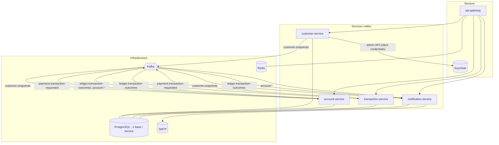
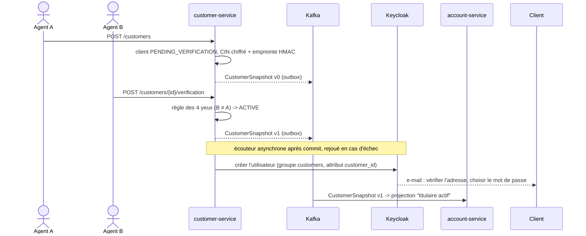
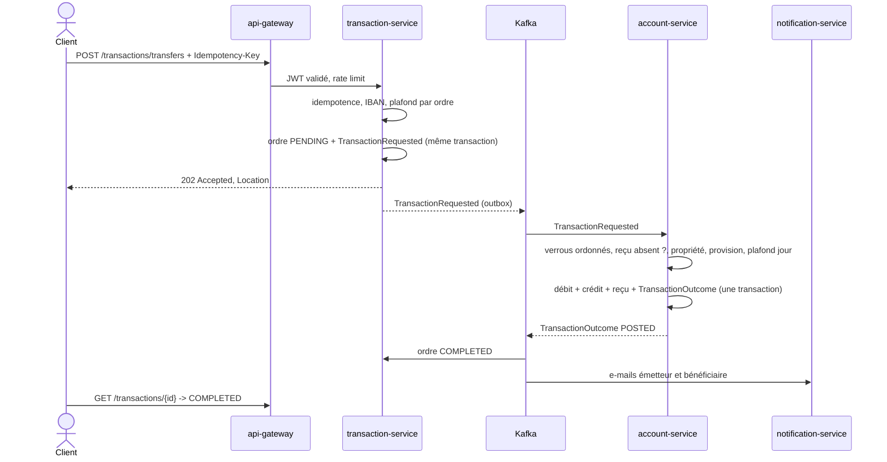

# Architecture d'Atlas Bank

## 1. Principes

1. **Une donnée, un propriétaire.** Chaque service possède sa base ; aucun service ne lit la base d'un
   autre. Les informations nécessaires ailleurs y sont répliquées par événements (projections locales).
2. **L'argent ne bouge qu'à un endroit.** Le solde n'existe que dans le grand livre d'account-service,
   modifié par des transactions ACID locales, en partie double (la caisse de l'agence est la
   contrepartie des opérations espèces). Il n'y a pas de transaction distribuée.
3. **Rien n'est perdu, rien n'est doublé.** Publication par *transactional outbox*, consommation
   idempotente, clés d'idempotence côté HTTP.
4. **Zero trust.** Chaque service revalide les jetons et les droits ; le grand livre revérifie les
   décisions des autres services avant de bouger de l'argent, et ne croit l'initiateur d'un ordre que
   si l'ordre est signé par transaction-service. Chaque service n'a que les droits dont il a besoin :
   rôle de base restreint, principal Kafka cloisonné par ACL, permissions Keycloak limitées.
5. **Personne n'agit seul sur l'argent d'autrui.** KYC et opérations du personnel au-delà des limites
   passent par un second employé.
6. **Pas de couplage temporel inutile.** Aucun appel synchrone entre microservices : une panne d'un
   service n'en bloque pas un autre.

## 2. Vue d'ensemble

## 3. Catalogue des événements

Les contrats vivent dans `platform/atlas-event-contracts` (records immuables, sans comportement). Le
suffixe `.v1` d'un topic fait partie du contrat : une évolution incompatible part sur un nouveau topic.

| Topic | Producteur | Consommateurs | Clé | Contenu |
|---|---|---|---|---|
| `atlas.customer.snapshots.v1` (compacté) | customer-service | account-service, notification-service | id client | État courant du client, versionné ; les consommateurs ignorent une version plus ancienne que celle qu'ils détiennent (l'ordre d'arrivée n'est pas garanti) |
| `atlas.payment.transaction-requested.v1` | transaction-service | account-service | compte débité (ou crédité pour un versement) | Ordre à imputer, initiateur et approbation (4 yeux) compris, **signé** en Ed25519 (ADR-0008) |
| `atlas.ledger.transaction-outcomes.v1` | account-service | transaction-service, notification-service | id de l'ordre | `POSTED` ou `REJECTED` + motif, parties concernées |
| `atlas.account.opened.v1` | account-service | notification-service | IBAN | Ouverture de compte |
| `atlas.account.status-changed.v1` | account-service | notification-service | IBAN | Gel, dégel, clôture et motif |

Chaque topic a un compagnon `<topic>.dlt` qui reçoit les messages en échec après les tentatives.
La topologie est déclarée une seule fois (`PlatformTopics`) et créée de façon idempotente par chaque
service au démarrage ; la création implicite par le broker est désactivée.

Le broker exige une authentification SASL de chaque client et refuse tout ce qu'une ACL n'autorise
pas (`deploy/kafka/init-acls.sh`) : chaque service n'écrit que les topics dont il est producteur dans
ce tableau, ne lit que ceux dont il est consommateur, et n'écrit que dans les `.dlt` de ce qu'il consomme.

## 4. Scénarios clés

### 4.1 Enrôlement et ouverture de l'accès en ligne

### 4.2 Virement

## 5. Modèle de sécurité

Les jetons d'accès émis par Keycloak portent :

| Claim | Source | Usage |
|---|---|---|
| `iss` | URL publique du realm | Vérifié par chaque service |
| `aud` = `atlas-api` | mapper d'audience | Un jeton émis pour une autre application est refusé |
| `roles` | mapper des rôles de realm | Autorités `ROLE_*` (configuration Spring Boot, sans code) |
| `preferred_username` | profil | Nom de l'acteur dans l'audit |
| `sub` | identifiant immuable de l'utilisateur | Clé d'idempotence par initiateur, règle des 4 yeux sur les ordres |
| `customer_id` | attribut utilisateur modifiable **par les administrateurs seulement** | Rattache l'utilisateur à son dossier client ; base de tous les contrôles de propriété |

Les services n'exposent aucun port hors du réseau interne ; seule la gateway est publiée.

| Frontière | Moindre privilège |
|---|---|
| Keycloak | Second facteur obligatoire pour `EMPLOYEE` et `ADMIN` ; le compte de service de customer-service ne gère que les membres de `/customers` (FGAP v2) |
| PostgreSQL | Par service : un rôle propriétaire pour les migrations, un rôle applicatif sans DDL ; journal et reçus en ajout seul pour ce rôle |
| Kafka | Un principal SASL par service, ACL par topic et par groupe, refus par défaut |
| Ordres de paiement | Signés par transaction-service (clé privée), vérifiés par le grand livre (clé publique) |
| Conteneurs | Utilisateur non-root, système de fichiers en lecture seule, aucune capacité Linux |

## 6. Organisation interne d'un service

Architecture hexagonale pragmatique, vérifiée par ArchUnit à chaque build :

- `domain` : agrégats riches (méthodes d'intention, invariants), objets valeur, codes d'erreur.
  Les annotations de mapping JPA y sont admises, Spring non.
- `application` : cas d'usage transactionnels, ports (interfaces) implémentés par l'infrastructure.
  Aucune dépendance vers le web, HTTP, Kafka ou Spring Security.
- `infrastructure` : adaptateurs. Les repositories Spring Data implémentent **directement** les
  ports applicatifs (méthodes dérivées, spécifications typées sur le métamodèle JPA), sans
  adaptateur écrit à la main.
- `web` : contrôleurs, autorisation par rôle, aucune logique métier.

## 7. Conventions transverses (starter de plateforme)

| Sujet | Convention |
|---|---|
| Erreurs | RFC 9457, `code` stable, `traceId`, `timestamp` ; 404 pour une ressource d'autrui ; 409 pour un conflit de concurrence ou un doublon ; 422 pour une règle métier |
| Pagination | `Pageable` Spring Data, taille plafonnée par configuration, sérialisation stable (`PagedModel`) |
| Temps | Une seule `Clock` injectée ; jours ouvrés évalués dans le fuseau de la banque (`BusinessCalendar`) |
| Argent | `Money` : `BigDecimal` + `Currency`, nombre de décimales tiré de la norme ISO 4217, arrondi refusé |
| Audit | Colonnes `created_*` / `last_modified_*` par Spring Data, historique Envers avec l'acteur |
| Concurrence | Verrou optimiste (`@Version`) sur les agrégats, verrou pessimiste ordonné dans le grand livre, `lock_timeout` et `statement_timeout` PostgreSQL |
| Messagerie | JSON sans en-tête de type, retries exponentiels, DLT, observation (traces) activée |
